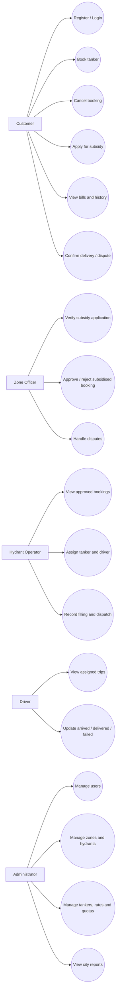

# PaaniLink Use Case Diagram

The diagram is written in Mermaid. GitHub and many Markdown viewers can render it.

## Actors
Customer, Zone Officer, Hydrant Operator, Driver and Administrator.

## Key authorization rule
An actor may view a record without having permission to modify it. Authorization must be enforced by the Phase 2 API, not only by hiding frontend controls.
